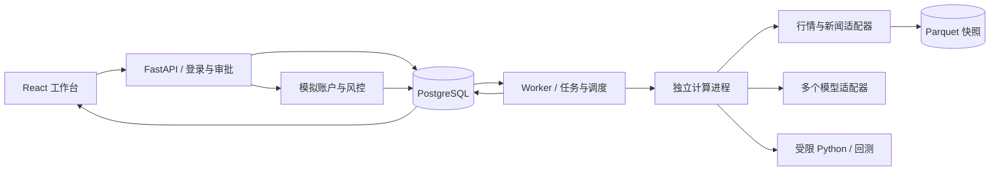

# 架构与开发约定

## 数据流

API 不同步执行回测；创建任务后返回202。Worker 使用条件更新认领任务，长计算在子进程完成，主进程更新心跳并响应取消。子进程只有纯计算与快照输出权限语义，业务数据库写入集中在父 Worker。Python 策略由 AST 解释器运行，没有真实 Python 执行权限；模型适配器自身属于可信应用代码，拥有配置的网络访问能力。

## 主要实体

- Asset：人工维护的标的；代码、市场、币种、每手数量不可原地改写；启停可修改。
- Strategy：不可变代码与参数版本；parent_id 构成版本链；candidate/approved 是审批状态。
- Provider：类型、驱动、优先级、启停和非敏感配置。
- Job：queued/running/succeeded/failed/cancelled，任务快照、结果、心跳和运行时间；事务内 finalizing 不对外作为稳定状态。
- Account：分数据环境和币种的模拟现金与持仓；revision 用于阻止旧审批作用于新账户状态。
- Order：模拟交易意图，人工确认后成交；绑定账户、标的、版本、价格、数量、生成时间和快照来源。
- Setting：风险参数、调度配置。
- Audit：人工操作及运行结果审计。当前追加写入，但未实现外部防篡改审计。

系统不自动购买标的、不自动批准策略、不自动重放交易任务、不自动切换券商。

## 接口契约

统一前缀 `/api`。除 `/health`、`/login` 外均使用 `Authorization: Bearer <token>`。登录有效期8小时；密钥轮换使已有 token 失效。退出登录清除当前浏览器 token；首版未实现逐 token 服务端撤销。

| 接口 | 方法 | 行为 |
|---|---|---|
| `/login` | POST | 密码换取签名 token |
| `/state` | GET | 页面所需实体摘要，不返回模型密钥 |
| `/strategy-monitor` | GET | 只读汇总全部已批准策略（另列撤销后仍有待确认虚拟订单的版本）的模拟信号任务、调度、订单与共享账户持仓；不产生信号或交易，不计算策略收益 |
| `/events` | GET | 认证 SSE 失效通知，客户端刷新状态；不是行情 tick 流 |
| `/assets` | POST | 人工创建标的 |
| `/assets/import` | POST | 最多100条，整批事务导入；冲突全部回滚 |
| `/assets/{id}` | PUT | 修改展示信息、标签与启停 |
| `/strategies` | POST | 校验并新建受限 Python 策略版本 |
| `/strategies/{id}/approve` | POST | 有成功回测或研究评估后人工批准 |
| `/strategies/{id}/revoke` | POST | 撤销批准，阻止新信号与旧订单确认 |
| `/providers`、`/providers/{id}` | POST / PUT | 添加或修改适配器配置 |
| `/jobs` | POST | 幂等提交研究、回测或信号任务 |
| `/jobs/{id}` | GET | 获取完整报告与运行清单 |
| `/jobs/{id}/cancel` | POST | 取消排队/运行任务，阻止结果入库 |
| `/jobs/{id}/retry` | POST | 创建新研究/回测任务，保留原配置；信号不支持旧状态重放 |
| `/orders/{id}/confirm` | POST | 再次风控，幂等模拟成交 |
| `/orders/{id}/cancel` | POST | 取消待确认订单 |
| `/live/orders` | POST | 始终返回409；未实现真实交易 |
| `/settings/risk` | PUT | 修改风险限制与紧急停止 |
| `/settings/schedule` | PUT | 修改当前单标的调度配置 |
| `/market`、`/news` | GET | 查看指数快照与聚合消息 |
| `/audit` | GET | 最近100条审计事件 |

错误使用 `{detail: ...}`；无效请求400/422，未登录401，冲突409，登录限频429。

## 策略执行

签名为 `target(history, params) -> float`。history 只包含截至当前决策日的收盘序列。返回0–1的目标仓位，风控进一步截断。

支持局部赋值、if/return、数值运算、比较、逻辑表达式、切片、mean/min/max/sum/len/abs。拒绝导入、属性访问、循环、函数嵌套、递归、任意调用、列表推导、乘幂。源码12000字符、AST600节点、单次评估2000表达式预算；Worker任务整体300秒超时。Compose Worker 限1 CPU、1GB内存、128进程。

该子集是首版的明确能力边界；不可宣传为完整 Python 沙箱。后续若支持任意 pandas/numpy 代码，必须增加独立、无凭据、无网络的容器沙箱及资源限制，不能直接将解释器替换成 eval/exec。

## 回测口径

单标的，单币种，纯多头。收盘产生下一日目标仓位，在下一根 bar 开盘成交。没有资金借贷。按每手数量取整，买入不能超过可用资金，零成交量不撮合，费用和滑点独立配置。估值使用当日收盘价。

年化交易日假定252；夏普无风险利率为0；净值回撤相对历史峰值；换手为总成交金额除初始资金；基准为同标的买入持有。报告保留该口径以及公司行动、真实交易规则、幸存者偏差的限制。分段研究评估从现金开始，有独立预热期，不等同重新训练的滚动拟合。

研究按时间前70%训练、后30%独立评估。模型仅能看到训练集摘要、最近90根训练行情、训练结束前可见新闻。多个模型各产出一个候选，按训练集夏普筛选，样本外指标只供人工判断。研究结果默认 candidate。对样本外反复人工筛选仍可能过拟合，当前不自动宣称统计显著性。

## 数据与模型扩展

新增行情实现 MarketDataProvider.bars，并在 MARKET_DRIVERS 注册；新增模型实现 propose，并在 MODEL_DRIVERS 注册。同时更新 ProviderInput 驱动白名单和前端配置表单。协议源码作为公共扩展边界；首版是代码级可插拔，不支持上传并执行任意第三方插件。

行情切源只针对完整一次查询，从高优先级到低优先级尝试。每次尝试失败被记录，不把多源价格平均，不在同一序列中静默混合。相同原始来源的价格口径需由适配器保证。真实与历史模式禁止演示源兜底。

新闻跨源聚合去重；模型跨源独立提案，再以固定规则评估。模型端点使用部署者配置的精确白名单；配置不能携带明文密钥。

未来券商适配器需实现 balances/positions/submit/order/cancel；必须通过订单状态机、查询优先重试、部分成交、撤单及对账验收后才能替换 live-disabled 入口。接口预留不代表已接入。

## 事务与恢复

模拟确认先按 pending 条件占用订单，再读取最新风控和账户。账户变更使用 revision 条件更新；订单、账户与审计一起提交。错误全部回滚。已成交订单重复确认只返回已有结果。

任务完成与取消使用条件更新协调。候选策略、订单意图、任务成功记录在同一事务写入，取消成功后不产生业务结果。心跳超过2分钟的运行任务标记失败；不会自动重放。成功任务保存行情 SHA-256 和 Parquet 路径；重放先校验冻结快照。

首版按单 Worker 部署。PostgreSQL 行锁和条件更新提供并发保护；SQLite 用于本地开发，尚未进行多进程压力验证。

## 持续迭代交接

修改系统时以本文件、schemas.py 和验收场景为依据；新增接口需同步前端类型、文档与针对行为的测试。任何模型自动修改系统代码只能产生待评审变更，不能自动部署或改变交易权限。

优先解决 ROADMAP 中的生产差距。不要因为已有演示流程便开启真实下单；不要把简化交易日历、价格口径和税费假设隐藏在通用引擎中。数据库当前使用 create_all 初始化，正式持续升级前需引入版本化迁移和恢复演练。
